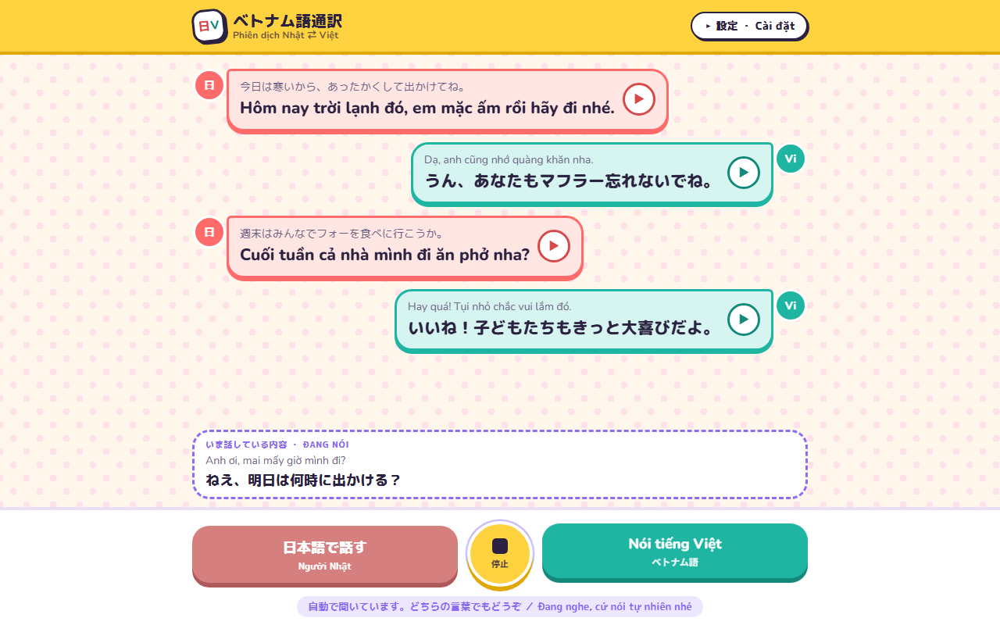
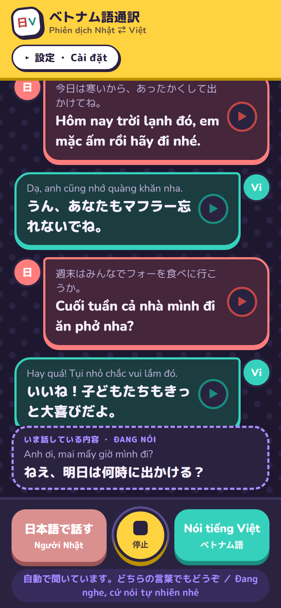

# ベトナム語通訳 / Phiên dịch Nhật ⇄ Việt

日本語とベトナム語で話す家族のための、話すだけでその場で訳して読み上げる会話アプリです。
1台のスマホやパソコンを家族で囲んで使います。

**公開ページ: https://wonderful-river-0b353b100.1.azurestaticapps.net/** （スマホでもそのまま使えます。家族の合言葉を設定すれば、キーの入力は不要です）

予備（サーバーなし・自分のキーで使う版）: https://katsunoshinutsumi.github.io/vietnamese-interpreter/

<p>
  
  
</p>

## できること

- **話した言語を自動で判定**: 真ん中の「自動」を押すと、日本語とベトナム語のどちらで話しても聞き分けて訳します（Azure 音声の連続言語判定）。判定した言語のボタンが光ります。
- **言語ボタンも使える**: 「日本語で話す」「Nói tiếng Việt」のボタンを押すと、その言語で聞き取ります。キーなしで使え、話し終えると相手の言語に自動で切り替わります。
- **家族向けのやさしい AI 翻訳**: 設定に Claude の API キーを入れると、直訳ではなく、家族の会話らしい温かい言い方に訳します。「家族メモ」（例：日本語はパパ、ベトナム語はママ）を書くと、ベトナム語の呼び方（con、mẹ、anh、em など）も合わせます。キーがないときは Google 翻訳を使います。
- **話している途中から訳を表示**: 話し終える前に、画面下に訳が出ます。
- **AI 音声で読み上げ**: Edge では Microsoft の AI 音声（HoaiMy、Nanami など）を使います。スマホでは端末に入っている音声を使います。
- **会話の履歴**: 吹き出しの ▶ で、もう一度読み上げられます。会話はその端末に保存され、次に開いたときも残っています（設定の「会話の履歴を消す」で消せます）。
- **大きい文字**: 設定で文字を大きくできます。
- **アプリとして使える**: スマホのブラウザで「ホーム画面に追加」すると、アプリのように開けます。
- スマホ対応で、ライトとダークの両方のテーマに対応しています。

## 使い方

1. 「設定」に Azure 音声のキーと地域（例：japaneast）を入れます。AI 翻訳を使うなら Claude の API キーと家族メモも入れます。キーはその端末のブラウザにだけ保存されます。
2. 真ん中の「自動」を押して、マイクの使用を許可します。
3. あとは日本語でもベトナム語でも、そのまま話すだけです。止めるときは真ん中のボタンを押します。

Azure のキーがないときは、「日本語で話す」か「Nói tiếng Việt」を押して、交互に話してください。

対応ブラウザ: Chrome、Edge、Android の Chrome、iPhone の Safari。インターネット接続が必要です。

### キーの用意

- **Azure 音声**: Azure ポータルで「Speech（音声）」のリソースを作り、キーと地域をコピーします。無料プランで毎月 5 時間まで使えます。
- **Claude**: https://console.anthropic.com で API キーを作ります。

## 仕組み

| 役割 | 使っているもの |
| --- | --- |
| 言語判定と文字起こし（自動） | Azure AI Speech の Speech SDK（連続言語判定、ja-JP と vi-VN） |
| 聞き取り（言語ボタン） | ブラウザの Web Speech API（SpeechRecognition） |
| 翻訳 | Google 翻訳（無料）。使えないときは MyMemory。サーバーに Claude のキーを入れた場合だけ、家族向けのやさしい表現の AI 翻訳を使う |
| 話している途中の訳 | Google 翻訳（速さ優先） |
| 読み上げ | ブラウザの speechSynthesis。端末に声がないときは Google のオンライン音声 |
| 画面 | HTML / CSS / JavaScript の1ファイル（フレームワークなし） |

- 読み上げた声をマイクが拾って訳し直さないよう、読み上げ中と直後の 0.6 秒は聞き取り結果を使いません。
- 話している途中の訳を覚えておき、話し終えた直後の表示に使うので、すぐに読み上げが始まります。
- 言語ボタンの聞き取りでは、文の途中の短い間で区切れないよう、話し終えてから 0.7 秒待って1回分の発言にします。

## 手元のパソコンで動かす

```bash
node server.js
```

http://localhost:8000 を開きます。`server.js` は、ページの配信と、オンライン音声の中継をします。

`#demo` を付けて開くと（http://localhost:8000/#demo）、会話の例が表示されます。`#demo-light`、`#demo-dark` でテーマも選べます。

## ポートフォリオ用の資料

- `docs/portfolio.html`: 作品紹介ページ
- `docs/screenshots/`: 画面写真（パソコン・スマホ × ライト・ダーク）
- 写真の撮り直し: `node server.js` を動かした状態で `node tools/screenshots.mjs`
